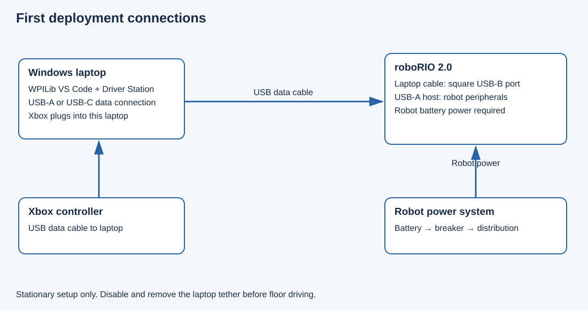
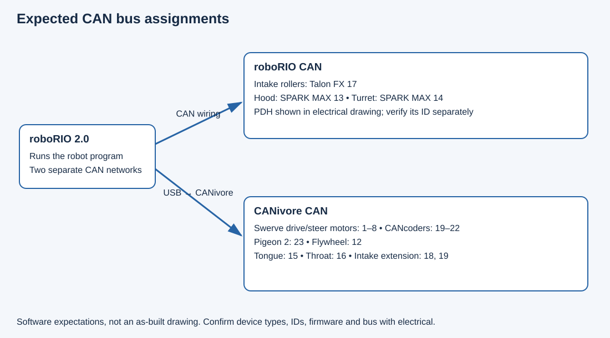
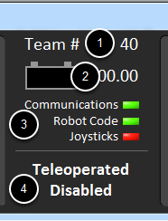
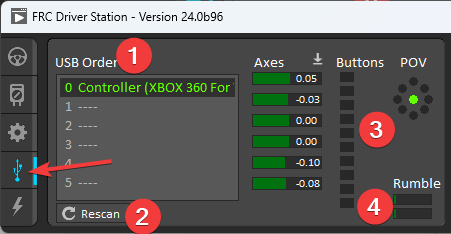
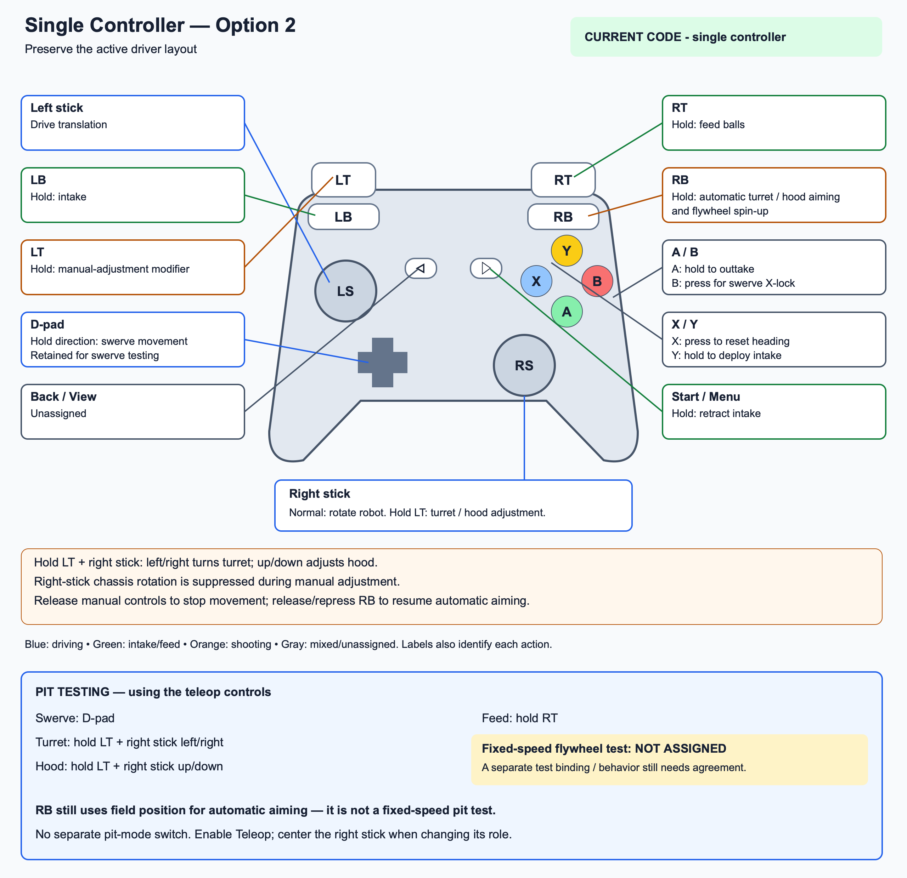

# Robot Deployment and Commissioning Guide

**Simsbury 4-H Robotics**
**Sim-City 3464**

This guide takes a new operator from a Windows laptop to deploying Team 3464's Java code on the robot's roboRIO 2.0, then checking the robot in stages. Start with a wired USB connection and leave the robot disabled until the electrical checks and mechanism references are confirmed.

**Deploying copies and starts the program. Enabling permits actuator output. Imaging replaces the roboRIO operating system. These are separate actions.** An ordinary code update does not require imaging.

Use the accompanying HTML version for offline reading or printing to PDF. The diagrams are connection illustrations, not photographs of this robot. Driver Station screenshots are official WPILib reference images; the installed version may look slightly different.

[TOC]

## 1 Deployment Prerequisites

### Workstation and Software Requirements

Use a Windows 11 x64 laptop with administrator access for installations, its charger, reliable internet for initial downloads, and access to the team's GitHub repository. Windows on ARM is not supported by the cited 2026 WPILib installer. Install before arriving at the robot. [WPILib installation](https://docs.wpilib.org/en/stable/docs/zero-to-robot/step-2/wpilib-setup.html)

| Tool | Needed for | What to install |
| --- | --- | --- |
| WPILib 2026 with its VS Code and Java tools | Build and deploy this Java project | The project uses GradleRIO 2026.2.1 and Java 17; start with the matching WPILib 2026.2.1 installer |
| NI FRC Game Tools 2026 | Driver Station, roboRIO utilities, USB drivers | Install the season-matched package and restart Windows |
| Git for Windows | Retrieve and update the team's code | Standard Git command-line installation |
| Phoenix Tuner X | CTRE motor, CANcoder, Pigeon and CANivore inventory | Official CTRE distribution |
| REV Hardware Client 2 | Identify and inspect SPARK MAX controllers | Version 2 for this project's 2026 REVLib |
| AdvantageScope | Live telemetry and saved log review | Useful during first testing; not required to deploy |
| Elastic or another existing team dashboard | Autonomous chooser and setup commands | Use the team's configured dashboard |
| PathPlanner editor | Inspect or edit paths | Optional; existing paths deploy with the project |
| SD image writer | Repair or initialize a roboRIO 2.0 microSD | Only if imaging is actually needed |

A separate full LabVIEW development installation is not needed for this Java project. Game Tools supplies the Driver Station and associated robot tools. [Game Tools installation](https://docs.wpilib.org/en/stable/docs/zero-to-robot/step-2/frc-game-tools.html)

Software library versions are not device firmware versions. Keep the repository's `vendordeps` files rather than updating everything during first deployment. The inspected code uses Phoenix 6 **26.1.1**, REVLib **2026.0.3**, AdvantageKit **26.0.1**, PathPlannerLib **2026.1.2**, and PhotonLib **v2026.2.2**. Record actual firmware separately and check vendor compatibility before changing it.

### Cabling and Test Equipment

| Item | Where it connects | Purpose |
| --- | --- | --- |
| USB-A to USB-B data cable | Laptop rectangular USB-A → roboRIO square USB-B device port | Recommended first deployment connection; often called a printer cable |
| USB-C to USB-B data cable, or a suitable USB-A adapter | USB-C-only laptop → same roboRIO USB-B port | Alternative to the cable above |
| Xbox controller data cable | Xbox controller → laptop | Match the controller connector: USB-C or Micro-USB depending on model |
| USB data cable with USB-C at the SPARK end | Laptop → individual SPARK MAX | REV diagnostics; separate from the roboRIO deployment connection |
| Ethernet patch cable | Laptop/USB Ethernet adapter → approved robot network port | Alternative network connection |
| USB Ethernet adapter | Laptop USB → Ethernet cable | If the laptop has no Ethernet jack |
| microSD reader and spare appropriate card | Laptop → removable microSD | Only for imaging/recovery |
| Robot logging USB drive | roboRIO USB-A host port, if available | Preserve `.wpilog` recordings; don't displace the CANivore connection |
| Charged robot battery and approved robot stand | Robot power and support | USB does not power the robot |

The roboRIO USB-B port is the laptop connection; its USB-A host ports serve attached devices. **Do not use an A-to-A USB cable between laptop and roboRIO.** [roboRIO USB ports](https://docs.wpilib.org/en/stable/docs/hardware/sensors/serial-buses.html)



Before moving cables, have someone familiar with the robot identify the roboRIO, CANivore, main breaker and radio. Do not unplug the CANivore to make room for the laptop: they use different roboRIO USB port roles.

## 2 Commissioning Roles and Test Sequence

Have one person operate the laptop and another watch the robot and keep the main breaker accessible. Ask the electrical team to bring the confirmed device inventory and the mechanical team to explain the turret/hood startup positions and intake travel endpoints.

The first session should accomplish these milestones in order:

1. Build the intended code on the laptop.
2. Connect to the powered but disabled robot.
3. Confirm bus assignments, devices and startup references.
4. Deploy and confirm that the intended program is running.
5. Observe sensors and errors while disabled.
6. Perform brief mechanism checks on an appropriate stand.
7. Test driving in a clear area using the robot network.
8. Only then test aiming, feeding and autonomous routines in a suitable shooting area.

Do not combine firmware updates, controller ID changes, code deployment and tuning into one unexplained change. Record each change and repeat the affected check.

## 3 Development Environment Installation

### WPILib Installation

1. Open the [WPILib installation page](https://docs.wpilib.org/en/stable/docs/zero-to-robot/step-2/wpilib-setup.html) and obtain the Windows x64 **2026.2.1** installer matching the project.
2. Mount the downloaded ISO in File Explorer and run `WPILibInstaller.exe`.
3. Install the development tools and WPILib's VS Code. Allow the installer to obtain its VS Code bundle while internet is available.
4. Open the installed **2026 WPILib VS Code**, not an unrelated editor shortcut.
5. Press `Ctrl+Shift+P`. Confirm commands beginning with `WPILib:` are available.
6. Do not accept an unrelated season/project upgrade prompt as part of this deployment.

### Driver Station and Vendor Utilities

1. Follow the [2026 Game Tools installer instructions](https://docs.wpilib.org/en/stable/docs/zero-to-robot/step-2/frc-game-tools.html). Allow the required NI components and drivers to install, then restart Windows.
2. Open **FRC Driver Station** from Windows Start. In Setup, enter team **3464**. Leave it disabled.
3. Install [Git for Windows](https://git-scm.com/downloads/win). Open a new terminal and run `git --version`.
4. Install [Phoenix Tuner X from CTRE's software page](https://store.ctr-electronics.com/pages/software).
5. Install [REV Hardware Client 2](https://docs.revrobotics.com/rev-hardware-client-2). The old client is not the correct tool for the project's 2026 REVLib. [REV client guidance](https://docs.revrobotics.com/rev-hardware-client)
6. Open each utility once while internet is available. Download any needed installer/firmware packages ahead of time, but do not flash devices just because a newer version is offered.

If school IT manages the laptop, resolve installation and network permissions beforehand. Avoid relying on a blanket firewall shutdown; configure the required applications with IT assistance.

## 4 Source Control and Deployment Baseline

Use the **approved deployment branch** identified by the software lead for the test session. Confirm that it contains the intended changes before building. No particular branch name or pending change is required by this procedure.

The repository URL and local folder below are examples for this team. Replace them if deploying another project. When prompted, enter the actual approved branch name.

Fetch and update the laptop checkout before building.

### Initial Repository Checkout

Open PowerShell and run one command at a time:

```powershell
New-Item -ItemType Directory -Force C:\FRC
Set-Location C:\FRC
$deploymentBranch = Read-Host "Enter the approved deployment branch"
git clone --branch "$deploymentBranch" https://github.com/FRC-Team-3464/2026-code.git
Set-Location C:\FRC\2026-code
git status --short
git branch --show-current
git log -1 --oneline
```

If GitHub asks for access, use the team's approved GitHub login flow. Never paste access tokens into shared screenshots or the guide.

### Updating an Existing Checkout

```powershell
Set-Location C:\FRC\2026-code
git status --short
```

If files are listed, stop and identify whose work it is before switching. Do not use `reset --hard`, force checkout or delete files to clear the warning.

With a clean checkout:

```powershell
$deploymentBranch = Read-Host "Enter the approved deployment branch"
git fetch origin
git switch "$deploymentBranch"
git pull --ff-only origin "$deploymentBranch"
git branch --show-current
git rev-parse HEAD
git rev-parse "origin/$deploymentBranch"
```

If the local branch does not exist, use `git switch --track "origin/$deploymentBranch"`. If fast-forward fails, ask the software team to reconcile the branch. The two full revision values should match for an unchanged deployment of the remote branch.

Record the revision in the test-session notes. This is how to identify the deployed code later; a branch name alone can refer to different versions over time.

### Configuration Verification

Open `C:\FRC\2026-code` in WPILib VS Code with **File → Open Folder**. The root contains `build.gradle`, `gradlew.bat`, `src`, and `.wpilib`.

Check:

- `.wpilib/wpilib_preferences.json`: team number 3464, project year 2026, Java.
- `Constants.java`: controller layout and profile. Confirm the required layout, controller type and port for this robot; do not infer them from the branch name.
- `Constants.java`: `kCANivoreBusName`. The base currently uses `"*"` for the first available CANivore and has a TODO for the confirmed name/serial. Confirm exactly one CANivore; do not guess a name.
- `ShooterConstants.java`: verify the configured turret and hood limits against the approved physical references and travel clearances for this robot.
- `Drive.java`: confirm the intended heading-reset and alliance behavior for the deployed version before running acceptance tests.

REAL mode is selected automatically on the roboRIO by `RobotBase.isReal()`. **Do not change `kSimMode` to REAL to deploy.** Desktop simulation and physical robot detection are already separated.

This project's deployment script can automatically stage and commit changes on branches whose names begin with `event`. Check whether the chosen deployment branch triggers that behavior. Do not rename a branch as a deployment workaround.

## 5 Build and Automated Validation

From a VS Code terminal in the project root:

```powershell
.\gradlew.bat spotlessCheck build
```

Wait for **BUILD SUCCESSFUL**. The first build needs internet to download Gradle and project dependencies. This runs the project's tests as well as compilation; all tests in the updated checkout must pass.

If Java is not found, use the WPILib terminal/tools or set the current PowerShell session to the installed WPILib JDK. For a standard all-users installation, first verify the directory exists:

```powershell
Test-Path C:\Users\Public\wpilib\2026\jdk\bin\java.exe
$env:JAVA_HOME = 'C:\Users\Public\wpilib\2026\jdk'
$env:Path = "$env:JAVA_HOME\bin;$env:Path"
java -version
.\gradlew.bat --version
```

Use the actual installation path if different. The project targets Java 17. Do not install arbitrary Java versions to chase errors.

If formatting or tests fail, save the first useful error and ask the software team to address it. Do not add `-x test` to bypass failures. When downloads fail, restore internet and retry; `--offline` only works once dependencies are cached.

Optional desktop preparation: run **WPILib: Simulate Robot Code** to become familiar with controls. Close the simulated Driver Station before connecting to the real robot. A passing SIM session does not confirm physical wiring or calibration.

## 6 Robot Preparation and Network Connectivity

### Prepower Inspection

- Remove game pieces for initial tests and keep people clear of wheels, belts, intake racks and shooter.
- Have the mechanical team place the robot on a stable stand suitable for drivetrain testing. Wheel clearance alone does not make the hood/intake safe to move.
- Confirm the normal startup position for the turret and hood. This code zeros their relative encoders during initialization; restarting or deploying in an arbitrary position can establish the wrong zero.
- Have electrical confirm battery, breaker, roboRIO power and CANivore USB wiring.
- Put the laptop where the stop operator can reach it without reaching over the robot.

**Do not enable merely because deployment succeeds.** This robot's hood default command can request its zero-angle position once enabled even without pressing an aiming button.

### USB Deployment Connection

1. Keep Driver Station disabled.
2. Plug the cable's USB-B end into the roboRIO **USB device** port; plug the other end into the laptop.
3. Connect the Xbox controller to a different laptop USB port. It does not plug into the roboRIO.
4. Power the robot from its battery. Wait for the roboRIO to boot.
5. Let Windows detect the NI USB network device.
6. Open PowerShell and test:

```powershell
ping 172.22.11.2
ping roboRIO-3464-FRC.local
```

The first address is the normal single-roboRIO USB address. A successful ping confirms basic reachability, not that the correct robot program is running. If USB ping fails, check power, data cable and Game Tools drivers first. [WPILib network troubleshooting](https://docs.wpilib.org/en/stable/docs/networking/networking-introduction/roborio-network-troubleshooting.html)

A USB connection is convenient for stationary checks. Disconnect the tether while disabled before floor driving; never drive away with the laptop attached.

### Ethernet and Radio Connectivity

Use the robot's already configured network and have the electrical/network lead identify a normal data port. Do not connect the laptop to an unidentified powered radio port. Leave Windows IPv4 on automatic unless the team has a documented alternative.

On the normal team network, try `roboRIO-3464-FRC.local`; the conventional team address is `10.34.64.2`. Direct laptop-to-roboRIO Ethernet without the radio can instead use link-local addresses, so that conventional address is not guaranteed. Confirm the actual interface address before changing settings. USB connectivity does not automatically provide direct access to every camera on the robot Ethernet network. [Network troubleshooting](https://docs.wpilib.org/en/stable/docs/networking/networking-introduction/roborio-network-troubleshooting.html)

## 7 Hardware Configuration Verification

Deploying a program can apply controller configuration and reset relative encoders even while disabled. Record the existing device inventory first where practical. Keep motor-control/test features in vendor utilities inactive.

### CAN Bus Topology and Device Assignments



The laptop talks to the roboRIO. Robot code selects the appropriate CAN bus for each controller. The two CAN networks are separate; changing a CAN ID does not move a device between them.

| Device | Expected ID | Expected bus | Exact code constant in `Constants.DeviceIDs` |
| --- | --- | --- | --- |
| Front left drive | 1 | CANivore | `kFrontLeftModuleDrive` |
| Front left steering | 2 | CANivore | `kFrontLeftModuleAzimuth` |
| Front right drive | 3 | CANivore | `kFrontRightModuleDrive` |
| Front right steering | 4 | CANivore | `kFrontRightModuleAzimuth` |
| Back left drive | 5 | CANivore | `kBackLeftModuleDrive` |
| Back left steering | 6 | CANivore | `kBackLeftModuleAzimuth` |
| Back right drive | 7 | CANivore | `kBackRightModuleDrive` |
| Back right steering | 8 | CANivore | `kBackRightModuleAzimuth` |
| Flywheel Talon FX | 12, needs physical confirmation | CANivore | `kTurretFlywheel` |
| Hood SPARK MAX | 13, needs physical confirmation | roboRIO | `kTurretHood` |
| Turret SPARK MAX | 14, needs physical confirmation | roboRIO | `kTurretAzimuth` |
| Tongue indexer | 15 | CANivore | `kIndexerTounge` |
| Throat indexer | 16 | CANivore | `kIndexerThroat` |
| Intake roller Talon FX | 17, needs physical confirmation | roboRIO | `kIntakeDrive` |
| Left intake extension | 18 | CANivore | `kLeftIntakePivot` |
| Right intake extension | 19 | CANivore | `kRightIntakePivot` |
| Front left CANcoder | 19 | CANivore | `kFrontLeftModuleEncoder` |
| Front right CANcoder | 20 | CANivore | `kFrontRightModuleEncoder` |
| Back left CANcoder | 21 | CANivore | `kBackLeftModuleEncoder` |
| Back right CANcoder | 22 | CANivore | `kBackRightModuleEncoder` |
| Pigeon 2 | 23 | CANivore | `kPigeon2` |

These are software expectations, not a signed-off inventory. Electrical must resolve IDs 9–11 and any extra devices. Record device type as well as number for both ID 19 entries; don't change either simply because their numbers match. Have the team verify device-type addressing before any renumbering.

### CTRE Device Inventory

1. Keep the robot disabled and connect Tuner to the roboRIO USB target or `172.22.11.2`.
2. Confirm the server connection and view devices on both the roboRIO and CANivore networks.
3. Capture device name/type, ID, bus, firmware, faults, and CANivore name/serial.
4. Identify each physical motor with the electrical team; a list of numbers alone cannot establish which mechanism is wired to it.
5. If the diagnostic server is unavailable, follow the official connection instructions with the software lead. Do not replace running robot code with diagnostic software without planning how to restore it.

[Tuner connection instructions](https://pro.docs.ctr-electronics.com/en/stable/docs/tuner/connecting.html) and [CANivore setup](https://pro.docs.ctr-electronics.com/en/stable/docs/canivore/canivore-setup.html).

### REV Device Inventory

Use a data-capable USB-C cable at each SPARK MAX and REV Hardware Client 2 to identify the hood and turret controller IDs and firmware. Have electrical arrange connections with power off, then supply power as required by the vendor procedure. Record before changing anything. Do not use the client's motor test controls during inventory. [SPARK MAX connection](https://docs.revrobotics.com/rev-hardware-client/ion/spark-max) and [RHC2 troubleshooting](https://docs.revrobotics.com/rev-hardware-client-2/rhc2/troubleshooting).

If a controller type, bus or ID differs from the table, pause powered testing and reconcile the software/wiring. A green Driver Station connection does not prove that every controller is reachable.

## 8 roboRIO Image Provisioning and Recovery

Skip this section if the robot already boots with a compatible 2026 image and team number 3464. Reimaging is not part of a normal code deploy and can remove the current program/configuration on the card.

If imaging is necessary, have the robot lead preserve the existing card or backup first:

1. Install Game Tools and obtain the official `FRC_roboRIO2_2026_...img.zip` image from its SD Images location.
2. Turn robot power off and remove the microSD card. Put it in the laptop reader.
3. In a supported image writer, select that roboRIO 2 image and the correct removable card. Verify the destination carefully; writing erases it.
4. Write and verify, safely eject, and put the card back in the unpowered roboRIO.
5. Power up, connect by USB, then set team 3464 using the supported team-number utility/startup settings.
6. If Windows offers to format the written card, decline.
7. Deploy the robot program again and repeat device/reference checks.

roboRIO 2 imaging uses the microSD workflow, not the roboRIO 1 direct-imaging process. Follow the current illustrated [official roboRIO 2 imaging instructions](https://docs.wpilib.org/en/stable/docs/zero-to-robot/step-3/roborio2-imaging.html) for exact utility screens.

## 9 Application Deployment

With successful build, confirmed startup positions, powered robot, and Driver Station disabled:

1. Verify the open folder is this repository, and `git branch --show-current` matches the approved deployment branch.
2. Close any active vendor motor-control sessions.
3. In WPILib VS Code press `Ctrl+Shift+P`.
4. Select **WPILib: Deploy Robot Code**.
5. Watch the terminal until the task completes successfully. Do not unplug power or USB during transfer.
6. Wait for the restarted program and check Driver Station messages.

Alternatively, from the project root:

```powershell
.\gradlew.bat deploy
```

Use one route, not both simultaneously. Do not use Java's standalone Run button or deploy a new template project. The repository deploy task also transfers `src/main/deploy`, including the PathPlanner assets. This project does not delete old remote deploy files automatically, so preserve the intended chooser/configuration instead of assuming the remote folder was wiped.

[Official WPILib build and deployment commands](https://docs.wpilib.org/en/stable/docs/software/vscode-overview/deploying-robot-code.html).

A successful deploy is not proof that the program stayed running. Check **Communications**, **Robot Code**, and messages while still disabled. Verify the build identity in the logged `GitBranch`, `GitSHA`, `BuildDate`, and dirty-state metadata when available. Do not rely on a moving dashboard widget as proof of the intended version.

## 10 Driver Station and Controller Configuration



Official reference image: [WPILib Driver Station documentation](https://docs.wpilib.org/en/stable/docs/software/driverstation/driver-station.html). Screen layout and example team numbers are illustrative.

1. Set team **3464**.
2. Select **Teleoperated**, keep **Disabled**, and confirm the expected alliance/station for the test.
3. In USB Devices, put the Xbox controller in slot **0**. Verify the axes, buttons and D-pad while disabled. Lock its slot if appropriate.
4. Release every button and center both thumbsticks before enabling.
5. Confirm Communications, Robot Code and controller recognition. Inspect messages rather than clearing unexplained errors.



Official reference image from the same WPILib page; this illustrates controller slots, not this team's actual connected devices.

For ordinary disabling, use the Disable button or Enter with Driver Station in focus. Space is the Driver Station emergency stop during non-FMS testing and requires reboot before re-enabling. In an FMS match, use the field's team-station E-stop. Reboot only after identifying the cause, with controls neutral and the robot cleared. [Driver Station controls](https://docs.wpilib.org/en/stable/docs/software/driverstation/driver-station.html)

**Driver Station Test mode is not a pit-shooting mode.** This repository's normal controller bindings require enabled Teleop. Do not enable Test/LiveWindow or vendor motor controls to bypass those bindings.

## 11 Operator Control Reference

The following table is a robot-specific single-controller example. Confirm the selected layout and bindings in the actual checkout before using it. These bindings are in `SingleDriverControls.java`; default subsystem behavior is in `DefaultControls.java`.



The repository controller picture is a quick reference. The table below calls out the behavior important during first testing.

| Control | Action | First-test consideration |
| --- | --- | --- |
| Left stick | Translate robot | Still active during manual aiming; keep centered during mechanism checks |
| Right stick horizontal | Rotate chassis | Changes role while LT is held |
| X | Heading reset | Fresh press in enabled Teleop establishes the current front as forward on either alliance |
| B | Request swerve X-lock | Not a substitute for Disable |
| D-pad | Robot-relative directional driving | Commands 1 m/s, not a gentle variable-speed module jog |
| LB | Intake collection | Rollers can run while held |
| A | Outtake | Check direction with no game pieces |
| Y | Extend/deploy intake while held | Open-loop; release before physical endpoint |
| Menu/Start | Retract intake while held | Open-loop; observe both sides and avoid binding |
| RT | Feed indexer | Manual feed does not guarantee shooter readiness |
| RB | Automatic turret, hood and flywheel requests | Depends on field pose; can rotate turret and spin flywheel |
| LT plus right stick horizontal | Manual turret | Center right stick at role change; use brief small input |
| LT plus right stick vertical | Manual hood | Physical direction must be verified; no full-range sweep initially |

Switching the right stick between chassis and manual aiming requires it to return near center. Manual override during RB requires releasing/repressing RB to resume automatic aiming. RB's flywheel request remains independent of manual turret/hood adjustment.

The hood can hold after manual movement while LT remains held, then return toward its default zero when LT/RB are released. **Releasing a mechanism button is not always a zero-output request. Use Disable if motion is unexpected.**

## 12 Hardware Commissioning and Acceptance Tests

### Stage A Disabled System Verification

Pass criteria: stable robot program, known device inventory, plausible feedback, no unexplained disconnects.

1. Select **Do Nothing** in the `Autonomous` chooser and verify the displayed selection.
2. Keep Disabled. Review DS messages for missing devices, exceptions and image/library mismatches.
3. Connect the team's dashboard/AdvantageScope to the real robot, not localhost SIM.
4. Inspect turret/hood position and connection values, module angles, gyro connection and field pose. Relative zero on startup alone is not proof of correct physical alignment.
5. Have the team explain any sensor zeros, inversions or encoder offsets that have not been measured.
6. Save screenshots and the device inventory before powered movement.

### Stage B Initial Enable and Disable Verification

Pass criteria: deliberate enable/disable, no unexplained motion, correct response to the stop operator.

1. Establish a clear area around all mechanisms. No game pieces.
2. Keep hands off controller buttons and sticks centered. Announce the first enable.
3. Enable Teleop briefly while the observer watches the hood and drivetrain. The hood may seek zero.
4. Disable immediately if anything moves unexpectedly, binds or makes abnormal noise.
5. Do not continue until the cause is understood. Do not try to fix a mechanical problem with the robot enabled.

### Stage C Drivetrain Commissioning

1. On the approved stand, use very small thumbstick requests and confirm all modules respond correctly. A wheel can point 180° away and spin oppositely due to swerve optimization; judge the combined rolling direction.
2. Test D-pad only after the team is ready for its fixed 1 m/s request. It moves the drivetrain, not just a selected module.
3. Verify B's X-lock request and Disable behavior.
4. If one module fights the others, disable and inspect its ID, encoder offset, inversion and wiring. Do not adjust several constants by guessing.
5. Disable, disconnect the USB tether, establish the radio/network connection, and move to a clear floor area before driving tests.
6. Use small translation and rotation inputs, verify robot-front convention (shooter is front), and record results.

### Stage D Heading Reset Acceptance Test

Verify the software-offset heading reset on both alliances:

1. In a clear area, choose Blue while disabled, then enable Teleop with sticks neutral.
2. Turn to a known direction, stop, and press/release X.
3. Push forward gently: motion should follow the direction the robot front pointed at reset.
4. Stop, rotate the chassis, then push forward gently again. Travel should still follow the established field-relative direction, rather than continually following the robot nose.
5. Repeat X and confirm a new forward direction is established.
6. Disable; select Red and repeat. The same reset behavior should apply.
7. Record whether the estimated X/Y stays fixed at reset and heading stays stable afterward.

Heading reset also changes estimated rotation. Do not assume an arbitrary driver reset establishes a correct field pose for shooting. Re-establish the known field pose before automatic aiming.

### Stage E Intake and Indexer Functional Tests

1. Confirm travel clearance and identify the extension/retraction endpoints with mechanical.
2. Use a brief Y request and check both intake extension motors move as intended; release well before the stop.
3. Use a brief Menu/Start request to retract. Stop if the sides disagree or rack motion binds.
4. Test LB and A briefly, confirming roller direction.
5. Test RT briefly and verify tongue/throat motion. Keep the shooter area clear even with no loaded game piece.
6. Disable between tests and record observations. There is no assumed automatic endpoint protection for these open-loop intake requests.

### Stage F Turret and Hood Manual Control Tests

1. Confirm physical zero, encoder conversion and clearance first. Inspect the deployed bounds, not just a diagram.
2. Keep the left stick centered and RB released. Hold LT, center the right stick, then apply a small horizontal request briefly.
3. Confirm physical turret direction agrees with increasing/decreasing reported angle. Disable if it does not.
4. Repeat with a small vertical request for the hood. Do not interpret the large negative hood encoder range as a physical tilt angle.
5. Observe what happens when the stick returns to center and when LT is released. Be prepared for the hood default return.
6. Limit checks must be planned by the mechanism lead. Do not drive into a mechanical stop to discover whether a software limit works.

Software should block outward manual requests at or beyond −80°/+80° and allow inward recovery. A valid physical zero and motor sign are prerequisites; the automated test alone cannot verify them.

### Stage G Aiming and Shooting Validation

This is a separate test in an appropriate shooting area, with a confirmed field reference and a spotter. It is not a first-enable pit action.

- RB uses the estimated field pose. With missing tags or an incorrect pose, it can request a large turret turn and an inappropriate shot.
- LT does not turn RB into a fixed-speed flywheel test. Avoid that combination as a workaround.
- Establish and check a real field pose and alliance first. A dashboard pose assignment changes the estimate, not physical robot position.
- Start with no game pieces and observe the requested/measured turret, hood and flywheel values.
- Test feed only after the mechanism lead approves the aim, speed, target area and stop plan. RT is a manual feed request.

### Stage H Autonomous Validation

Only after driving, localization and mechanisms pass their checks:

1. Disable and select the intended URI routine on the dashboard. Confirm alliance.
2. Read `Auto Start/Placement` and the `Auto Start` field marker. Place the physical robot at that actual pose.
3. While disabled, use `Apply Auto Starting Pose`. Verify the estimate matches placement; do not click it to disguise a placement mismatch.
4. Clear the entire path and shooting area. These routines can operate multiple mechanisms and shoot.
5. Select Autonomous and enable only on the observer's readiness call. Keep the stop operator ready.
6. Disable after the run and inspect logs. A completed path does not prove a ball was collected or scored.
7. Return the chooser to Do Nothing before unrelated tests.

Practice mode automatically advances through match phases. Use it only after individual mode tests, not as the first test session.

## 13 Telemetry and Test Records

This code publishes AdvantageKit telemetry and starts a REAL log writer. It expects normal roboRIO USB logging at `/U/logs`; confirm storage is present and a file is actually being written. Live telemetry alone is not a saved recording.

For each test, record:

| Item | Record |
| --- | --- |
| Date and operator | |
| Deployed revision and build identity | |
| Driver Station and roboRIO image versions | |
| Controller layout and port | |
| CANivore name/serial and firmware | |
| Device inventory/screenshots | |
| Battery and test setup | |
| Alliance, mode and starting pose | |
| Test input and expected motion | |
| Actual motion and observed errors | |
| Log filename and approximate event time | |
| Pass, fail, or not tested | |

Connect AdvantageScope using its live robot connection settings and the real robot address/team. See the team's [AdvantageScope setup](../../visualization/advantagescope/README.md) for the CAD model and logged fields. Download logs using the team's established robot-log transfer workflow or retrieve the logging drive after disabling and powering down. Keep DS logs as well as `.wpilog` files when diagnosing connection problems.

## 14 Deployment and Runtime Troubleshooting

| Symptom | First checks | Next step |
| --- | --- | --- |
| No WPILib commands in VS Code | Correct 2026 WPILib VS Code installed/open | Repair installation; don't create a replacement project |
| Java not found | WPILib JDK path and terminal environment | Use installed Java 17; restart terminal |
| Dependency download failed | Internet, proxy and cache | Build online before robot session |
| Formatting/tests fail | First failure in terminal/report | Resolve with software team; don't skip tests |
| USB ping fails | Robot power, cable data capability, NI drivers | Try known-good cable/port and inspect Windows network devices |
| USB IP works but hostname fails | Team number/mDNS and competing network adapters | Use official network troubleshooting; don't reimage immediately |
| Communications green but Robot Code red | Crash messages, incompatible image/library, incomplete deploy | Save error output and inspect program startup |
| Controller not recognized | Laptop USB connection and DS slot | Rescan while disabled, lock port 0, verify every axis |
| Robot Code green but motors disconnected | Device type, ID, bus, CANivore USB, power | Electrical inventory; green code is not a CAN health check |
| Tuner shows only one bus | Target selection, CANivore detection and wiring | Check both networks explicitly |
| Hood moves when enabling/releasing LT | Default zero request and physical startup reference | Disable; verify mechanism reference and expected return |
| Right stick seems inactive after LT | Neutral rearming requirement | Center both right-stick axes before changing role |
| D-pad does nothing in DS Test | Bindings are Teleop-only | Use the staged Teleop procedure, not bypass controls |
| Turret turns unexpectedly on RB | Incorrect field pose/alliance/reference | Disable; do not repeatedly retry automatic aim |
| Turret can't recover inward | Encoder reading, requested direction, connection and physical obstruction | Disable; inspect logs, physical reference and deployed configuration |
| Voltage drops/reboots | Battery, connections, load and CAN faults | Electrical inspection before continuing |
| No autonomous choices/paths | Startup errors and deployed assets | Confirm build, files, chooser and correct code version |
| No saved log | USB storage/path/capacity and logger errors | Confirm actual file creation before next useful test |
| E-stopped | Cause of emergency and robot state | Resolve cause before reboot and deliberate re-enable |

Do not turn the main breaker off while flashing firmware or writing an SD image. For an immediate physical hazard, stopping the robot takes priority; investigate possible incomplete updates afterward.

## 15 Shutdown and Deployment Recovery

1. Disable and release all controls.
2. Save logs, screenshots and failed-test details.
3. Power down before moving the robot, removing the logging drive or servicing mechanisms.
4. Record the final deployed version and unresolved issues for the next operator.
5. If a new program does not start or behaves incorrectly, have software select a known-good version compatible with the **current wiring** and redeploy while disabled. Older code that assumes a single CAN bus may not be a suitable rollback.
6. Recheck startup references after any program restart. Do not assume relative encoders retained their physical zero.

## 16 Deployment and Commissioning Checklist

- [ ] Laptop tools installed and project builds successfully.
- [ ] Intended remote code fetched; branch and deployed revision recorded.
- [ ] Controller layout, mechanism limits and heading-reset configuration verified for the deployed version.
- [ ] Electrical inventory, both buses and unknown IDs resolved for powered tests.
- [ ] Turret/hood startup references and intake clearance confirmed.
- [ ] Robot supported, game pieces removed, stop operator ready.
- [ ] USB connected to roboRIO USB-B; Xbox connected to laptop.
- [ ] Team 3464; Driver Station disabled; communication verified.
- [ ] Deploy completed; correct program identity and messages checked.
- [ ] Do Nothing selected; controller slot 0 verified with controls neutral.
- [ ] Disabled sensor checks complete before first enable.
- [ ] Mechanisms and driving tested in stages; logs saved.
- [ ] Automatic aiming/autonomous deferred until field pose and clear test area are ready.

## References and Image Attribution

The two Driver Station screenshots are reproduced from WPILib documentation with links beside them. The cable and CAN diagrams are schematic illustrations created for this guide. They are not as-built electrical drawings. Existing controller art comes from this repository.

- [WPILib installation and supported platforms](https://docs.wpilib.org/en/stable/docs/zero-to-robot/step-2/wpilib-setup.html)
- [NI FRC Game Tools installation](https://docs.wpilib.org/en/stable/docs/zero-to-robot/step-2/frc-game-tools.html)
- [roboRIO USB port roles](https://docs.wpilib.org/en/stable/docs/hardware/sensors/serial-buses.html)
- [roboRIO 2 microSD imaging](https://docs.wpilib.org/en/stable/docs/zero-to-robot/step-3/roborio2-imaging.html)
- [WPILib deployment](https://docs.wpilib.org/en/stable/docs/software/vscode-overview/deploying-robot-code.html)
- [Driver Station screens and operation](https://docs.wpilib.org/en/stable/docs/software/driverstation/driver-station.html)
- [Network troubleshooting](https://docs.wpilib.org/en/stable/docs/networking/networking-introduction/roborio-network-troubleshooting.html)
- [Phoenix Tuner connections](https://pro.docs.ctr-electronics.com/en/stable/docs/tuner/connecting.html)
- [CANivore setup](https://pro.docs.ctr-electronics.com/en/stable/docs/canivore/canivore-setup.html)
- [REV Hardware Client 2](https://docs.revrobotics.com/rev-hardware-client-2)
